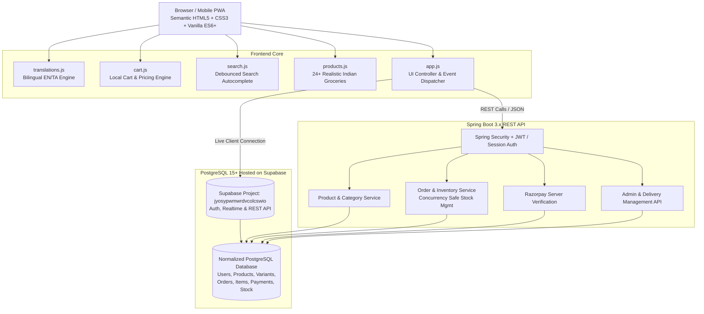

# Meenachi Grocery - Online Supermarket Platform

> **"Freshness at Your Doorstep"**  
> Premium, trustworthy South Indian online grocery platform built with semantic HTML5, Vanilla CSS3, Vanilla ES6+ JavaScript, Java Spring Boot, PostgreSQL, and Razorpay.

---

## 🏛️ System Architecture



---

## ⚡ Supabase Setup & One-Click Database Schema

We have generated a complete, production-ready PostgreSQL migration file in [`database/schema.sql`](file:///e:/meeanch_grosary/Meeanch_oil/database/schema.sql).

### How to apply the schema to your Supabase project:
1. Open your [Supabase Dashboard](https://supabase.com/dashboard/project/jyosypwmwrdvcolcswio).
2. Navigate to the **SQL Editor** tab on the left sidebar.
3. Click **New Query**.
4. Copy the entire contents of [`database/schema.sql`](file:///e:/meeanch_grosary/Meeanch_oil/database/schema.sql) and paste it into the editor.
5. Click **Run** (or press `Ctrl+Enter`).

This will automatically create:
- `public.profiles` (linked to `auth.users`)
- `public.addresses`
- `public.categories` (pre-seeded with all 11 Indian grocery categories)
- `public.products` & `public.product_variants` (pre-seeded with South Indian staples)
- `public.inventory_movements`
- `public.coupons` (pre-seeded with `MEENACHI150`, `FARM10`, `FREESHIP`)
- `public.orders` & `public.order_items`
- `public.deliveries`
- `public.reviews`
- All necessary indexes and Row Level Security (RLS) policies.

---

## 🎯 Brand Identity & Color Palette

- **Brand Name**: Meenachi Grocery
- **Tagline**: Freshness at Your Doorstep
- **Primary Color**: Forest Green `#19583B` (symbolizing freshness, trust, and natural quality)
- **Background**: Warm Cream `#F8F6EE` (authentic Indian grocery parchment warmth)
- **Card & Surface**: Pure White `#FFFFFF`
- **Accent**: Warm Harvest Orange `#E99A38` (symbolizing turmeric, spice warmth, and festive harvest)
- **Typography**: Outfit & Plus Jakarta Sans (Google Fonts)

---

## 🗺️ 10-Phase Implementation Roadmap

| Phase | Milestone | Deliverables / Status |
|---|---|---|
| **Phase 1** | **Modern Responsive Homepage** | ✅ **COMPLETE** - Announcement bar, bilingual EN/TA switch, PIN delivery checker, search-as-you-type, hero banner, 11 category cards, Best Sellers, Today's Offers, Monthly Family Pack card, Benefits, Newsletter, genuine customer reviews, FAQ accordions, e-commerce footer, slide-in cart drawer, mobile bottom navigation. |
| **Phase 2** | **Product Catalogue & Details** | `pages/shop.html`, `pages/product.html`, multi-facet filters (category, price slider, in-stock, pack sizes), sorting (price low-high, popularity, newest), search query handling, load more. |
| **Phase 3** | **Cart, Coupons & Checkout Demo** | `pages/cart.html`, `pages/checkout.html`, delivery slot picker, address form validation, Indian PIN code verification, discount voucher validation (`MEENACHI150`, `FARM10`), order confirmation summary. |
| **Phase 4** | **Customer Account & Auth** | `pages/login.html`, `pages/register.html`, `pages/account.html`, `pages/orders.html`, order timeline status tracker (Placed ➔ Confirmed ➔ Packed ➔ Dispatched ➔ Delivered), re-order last basket. |
| **Phase 5** | **Spring Boot REST Backend & PostgreSQL** | Spring Boot 3 app, JPA/Hibernate entities, Liquibase/Flyway migrations, normalized relational schema, BCrypt password hashing, Spring Security role-based access (ROLE_CUSTOMER, ROLE_ADMIN, ROLE_DELIVERY). |
| **Phase 6** | **Frontend-Backend API Integration** | Synchronizing local cart with server cart upon login, optimistic UI updates, concurrency-safe checkout transactions with row-level locks on stock. |
| **Phase 7** | **Razorpay Payment Verification & Delivery Slots** | Razorpay Order API integration, webhook handling, SHA256 signature verification, COD validation, SMS/WhatsApp order confirmation. |
| **Phase 8** | **Admin & Delivery Staff Dashboards** | `pages/admin/` (Sales charts, Product CRUD, Stock adjustment logs, Order dispatch status, CSV export) & `pages/delivery/` (Assigned orders, customer address & landmark navigation, delivery confirmation OTP). |
| **Phase 9** | **QA, Accessibility & Performance** | Lighthouse 95+ score, WCAG 2.1 AA color contrast compliance, keyboard focus trapping on modals, fast image loading with lazy attributes & fallbacks. |
| **Phase 10**| **Deployment & Production Hardening** | Static frontend hosting (Cloudflare / Netlify / Vercel), containerized Spring Boot backend (Docker, Railway / Render / AWS ECS), managed PostgreSQL (Supabase / RDS), SSL/TLS, CORS configuration, Rate limiting. |

---

## 📁 Project Folder Structure

```
meenachi-grocery/
├── frontend/                     # Client Web Application
│   ├── index.html               # Customer Homepage
│   ├── css/
│   │   ├── style.css            # Core design system tokens & component styles
│   │   └── responsive.css       # Mobile bottom navigation & responsive breakpoints
│   ├── js/
│   │   ├── supabaseClient.js    # Client-side Supabase SDK initialization & connection test
│   │   ├── dbService.js         # API & DB Service (Express API -> Supabase -> local fallback)
│   │   ├── translations.js      # Centralized bilingual English & Tamil dictionary
│   │   ├── products.js          # Realistic South Indian grocery items & helper queries
│   │   ├── cart.js              # Cart state manager, localStorage, coupons & bill math
│   │   ├── search.js            # Instant debounced search with keyword highlighting
│   │   └── app.js               # Main UI coordinator, PIN checker, modals, drawer
│   └── pages/
│       ├── shop.html            # Product Catalogue & Filtering
│       ├── checkout.html        # Checkout & Address Form
│       ├── orders.html          # Customer Order History & 5-Stage Timeline
│       ├── wishlist.html        # Customer Saved Items
│       ├── account.html         # Customer Profile & Preferences
│       ├── login.html           # Customer Sign In (Supabase Auth)
│       ├── register.html        # Customer Registration (Supabase Auth)
│       ├── admin/
│       │   └── index.html       # Administrator Portal
│       └── delivery/
│           └── index.html       # Delivery Partner Portal
├── backend/                      # Express.js REST API Server
│   ├── server.js                # Express Server, CORS, Static Frontend Hosting & Routes
│   ├── package.json             # Express, @supabase/supabase-js, CORS, Dotenv
│   ├── .env                     # Supabase URL & Key Configuration
│   ├── .env.example             # Environment template
│   └── src/
│       ├── config/
│       │   └── supabase.js      # Backend Supabase client
│       ├── routes/
│       │   ├── products.js      # GET /api/products, POST, PUT, DELETE
│       │   ├── categories.js    # GET /api/categories
│       │   ├── orders.js        # GET /api/orders, POST /api/orders, PATCH /api/orders/:id/status
│       │   ├── coupons.js       # POST /api/coupons/validate
│       │   └── auth.js          # POST /api/auth/register, /api/auth/login, /api/auth/logout
│       └── middleware/
│           └── errorHandler.js  # Centralized error handler
├── database/
│   └── schema.sql               # Production PostgreSQL schema for Supabase SQL Editor
└── README.md                    # Project Architecture & Setup Guide
```

---

## ⚙️ Running Locally

### Option 1: Run Express Server (Serves Backend API + Frontend together)
```bash
cd backend
npm install
npm start
```
The server will start at:
- **Frontend App**: `http://localhost:5000/index.html`
- **API Healthcheck**: `http://localhost:5000/api/health`
- **Products API**: `http://localhost:5000/api/products`

### Option 2: Run Frontend standalone (VS Code Live Server or Python)
```bash
cd frontend
python -m http.server 8080
```
Open `http://localhost:8080/index.html`. It will automatically connect to `http://localhost:5000/api` or fallback to client-side Supabase!
